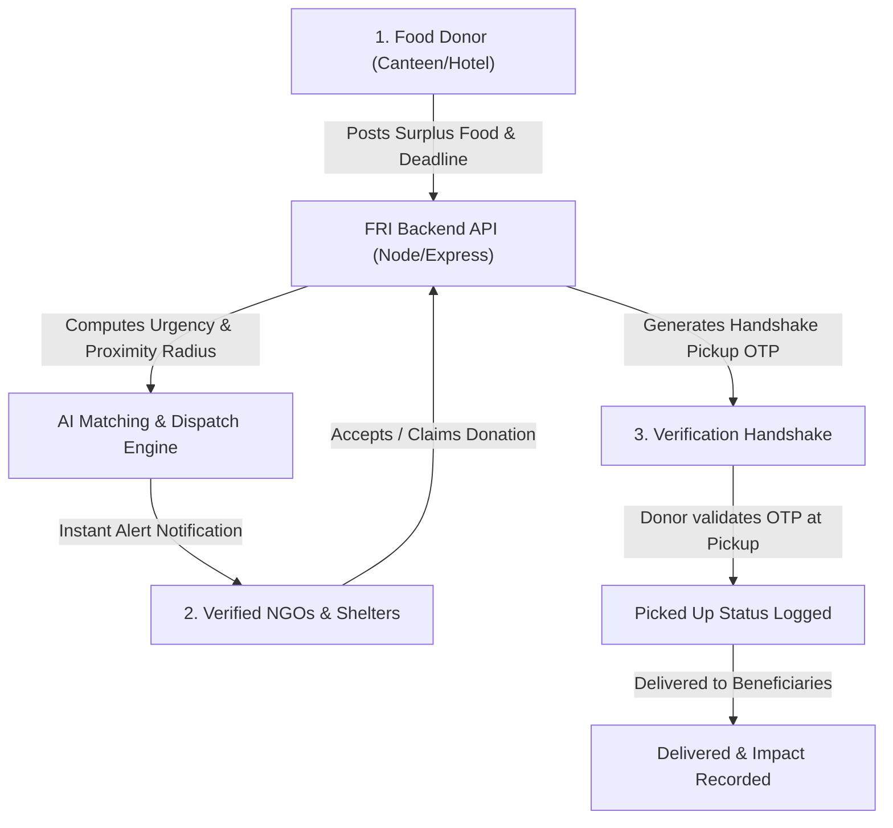

# 🍲 Food Rescue Intelligence (FRI)
> **A Smart Surplus Food Redistribution & NGO Coordination Platform**  
> *Academic Project — Department of Computer Science & Engineering, IET Lucknow (Group No. 15)*

---

## 📌 Overview

Every day, vast amounts of edible cooked food from university canteens, college messes, banquet halls, and restaurants are discarded due to volatile daily attendance and narrow safe consumption windows (4–6 hours). Meanwhile, millions suffer from food insecurity.

**Food Rescue Intelligence (FRI)** is a real-time, authenticated web platform designed to eliminate communication latency and bridge food donors directly with verified NGOs, orphanages, and shelter homes before perishable food degrades.

---

## 🚀 Key Features

* **🔐 Multi-Tier Secure Authentication:**
  * Multi-role onboarding: `donor`, `ngo`, `volunteer`, `admin`.
  * Dual Two-Factor Authentication (2FA) via **Email OTP** (Nodemailer) and **SMS OTP**.
  * Instant verified sign-in via **Google OAuth 2.0**.
  * Session protection using encrypted **JWT HTTP-only cookies** and salted **Bcrypt** hashing.
* **🏢 Organization Entity Decoupling:**
  * Clean separation of personal user credentials from business/charity entity profiles.
  * Native **GeoJSON (`2dsphere`) spatial indexing** for rapid distance calculations.
* **🧠 AI & Weighted Matching Algorithm:**
  * Evaluates donation urgency, spatial proximity, and recipient intake capacity:
    $$\text{Match Score} = (0.45 \times \text{Proximity}) + (0.35 \times \text{Urgency}) + (0.20 \times \text{Capacity})$$
* **🤝 Fraud-Proof Handshake Verification (OTP):**
  * When an NGO claims food, a unique 4-digit **Pickup Handshake OTP** is generated. The donor validates the OTP physically at pickup, preventing food diversion.
* **📜 Immutable Status Event Audit Trail:**
  * Event-sourcing history tracking each transition (`available` ➔ `reserved` ➔ `picked_up` ➔ `delivered`) with timestamps and user accountability.

---

## 🏗️ System Architecture & Workflow



---

## 🗄️ Database Architecture (Mongoose Models)

| Model | Purpose | Key Attributes |
| :--- | :--- | :--- |
| **`User`** | Identity & Access Control | `name`, `email`, `role`, `password`, `isEmailVerified`, `emailOtp`, `phoneOtp`, `googleId` |
| **`Organization`** | Business / NGO Profile | `user` (ref), `name`, `type` (`donor`/`ngo`), `address`, `city`, `location` (GeoJSON Point), `isVerified` |
| **`FoodListing`** | Surplus Food Donations | `organization`, `donorUser`, `foodName`, `dietaryType`, `quantity`, `unit`, `preparedAt`, `pickupDeadline`, `status` |
| **`Match`** | System AI Recommendations | `foodListing`, `ngoOrganization`, `matchScore` (0–100), `status` (compound unique index) |
| **`DonationRequest`**| NGO Formal Claim | `foodListing`, `ngoOrganization`, `ngoUser`, `pickupOtp`, `status` (`pending`, `approved`, etc.) |
| **`StatusEvent`** | Audit History & Compliance | `foodListing`, `oldStatus`, `newStatus`, `changedBy` (ref User), `changedAt`, `notes` |

---

## 🛠️ Tech Stack

* **Frontend:** React.js, Tailwind CSS
* **Backend:** Node.js, Express.js (REST API Architecture)
* **Database:** MongoDB Atlas (Mongoose ODM with `2dsphere` indexes)
* **Authentication:** JWT, Bcrypt.js, Google OAuth 2.0 (`google-auth-library`), Nodemailer
* **Intelligence Layer:** LangChain & LLM APIs for unstructured extraction, Haversine formula for spatial distance

---

## 📋 API Endpoints Summary

### Authentication (`/api/auth`)
* `POST /api/auth/register` — Register new user & trigger Email OTP
* `POST /api/auth/verify-email-otp` — Verify registration or login Email OTP
* `POST /api/auth/login` — Password check & trigger 2FA OTP
* `POST /api/auth/send-phone-otp` — Dispatch SMS OTP
* `POST /api/auth/verify-phone-otp` — Verify SMS OTP & issue JWT
* `POST /api/auth/google` — Google OAuth authentication
* `GET  /api/auth/me` — Fetch authenticated user profile
* `PUT  /api/auth/profile` — Update user details, role, and address
* `POST /api/auth/logout` — Clear session cookies

### Organization (`/api/organizations`)
* `POST /api/organizations` — Register canteen/restaurant or NGO profile with coordinates
* `GET  /api/organizations/me` — Get current user's organization profile
* `PUT  /api/organizations/me` — Update organization information and GPS coordinates
* `GET  /api/organizations/:id` — View public organization profile

---

## ⚡ Getting Started

### Prerequisites
* [Node.js](https://nodejs.org/) (v18.0.0 or higher)
* [MongoDB](https://www.mongodb.com/) (Local instance or MongoDB Atlas URI)

### Setup & Installation

1. **Clone the repository:**
   ```bash
   git clone https://github.com/Aadipanday/Food-Rescue-Intelligence.git
   cd Food-Rescue-Intelligence/backend
   ```

2. **Install dependencies:**
   ```bash
   npm install
   ```

3. **Configure Environment Variables:**
   Create a `.env` file inside the `backend/` directory:
   ```env
   PORT=5000
   NODE_ENV=development
   CLIENT_URL=http://localhost:5173
   MONGO_URI=mongodb+srv://<username>:<password>@cluster.mongodb.net/food-rescue
   JWT_SECRET=your_jwt_secret_key_here
   GOOGLE_CLIENT_ID=your_google_client_id_here
   EMAIL_HOST=smtp.gmail.com
   EMAIL_PORT=587
   EMAIL_USER=your_email@gmail.com
   EMAIL_PASS=your_app_password
   ```

4. **Run the development server:**
   ```bash
   npm run dev
   ```
   The backend API will run on `http://localhost:5000`.

---

## 👥 Project Team (Group No. 15)

* **Aditya Panday** (Roll No: `2400520100010`)
* **Devendra Singh** (Roll No: `2400520100033`)
* **Ayushman Agrahari** (Roll No: `2400520100027`)

**Project Supervisor:** Assistant Professor Nikita Gond  
**Department:** Computer Science & Engineering, **Institute of Engineering & Technology (IET), Lucknow**  
**Academic Session:** 2026 – 2027

---

## 📜 License
This project is licensed under the ISC License.
